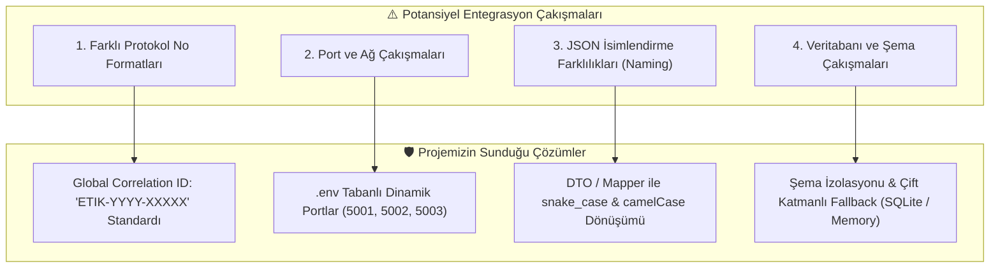
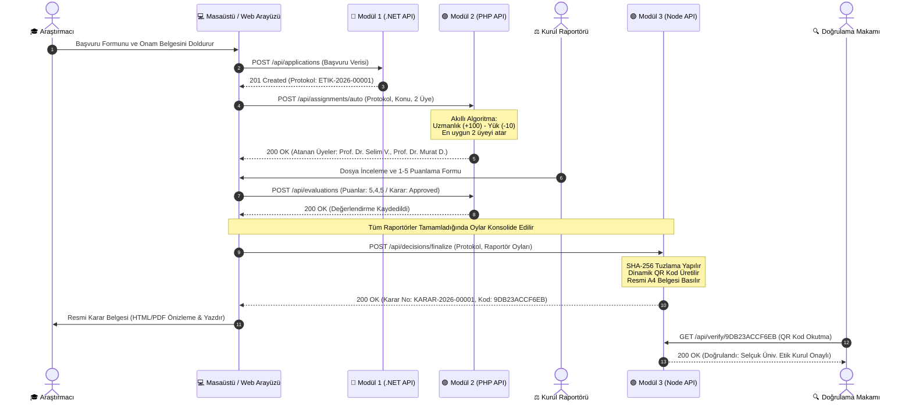

# 🔄 ETİK KURUL OTOMASYONU — SİSTEM ENTEGRASYON VE BİRLEŞTİRME (MERGE) REHBERİ
## BİLGİSAYAR MÜHENDİSLİĞİ UYGULAMALARI DERSİ — GRUPLAR ARASI TEKNİK DÖKÜMAN

---

### 📌 DÖKÜMAN KİMLİĞİ VE AMACI

| Alan | Bilgi |
|---|---|
| **Ders / Kurum** | Bilgisayar Mühendisliği Uygulamaları — Selçuk Üniversitesi Teknoloji Fakültesi |
| **Geliştirici / Proje Sahibi** | Mehmet Akif Ürey (233311066) |
| **Hedef Kitle** | Aynı konuyu çalışan diğer proje grupları, ders yürütücüsü ve entegrasyon ekibi |
| **Amaç** | Ara sınav sonrası tüm grupların geliştirdiği en iyi özellikleri tek bir ana sınıf projesinde birleştirirken (merge) çakışmaları önlemek, bağımlılıkları netleştirmek ve modül transferini sorunsuz gerçekleştirmek. |
| **Kaynak Kod Deposu** | [https://github.com/Mehmet-Akiff/EtikKurulOtomasyonu](https://github.com/Mehmet-Akiff/EtikKurulOtomasyonu) |

---

## 📑 İÇİNDEKİLER

1. [Entegrasyon Vizyonu ve Güçlü Modüllerimiz](#1-entegrasyon-vizyonu-ve-güçlü-modüllerimiz)
2. [Modüler Bağımlılık Matrisi (Dependency Matrix)](#2-modüler-bağımlılık-matrisi-dependency-matrix)
3. [Taşınabilir Modüller ve Dosya Göç Listesi (Migration List)](#3-taşınabilir-modüller-ve-dosya-göç-listesi-migration-list)
4. [Olası Çakışma Noktaları ve Çözüm Stratejileri (Conflict Prevention)](#4-olası-çakışma-noktaları-ve-çözüm-stratejileri-conflict-prevention)
5. [Uçtan Uca Entegrasyon Akışı (Mermaid Sequence Diagram)](#5-uçtan-uca-entegrasyon-akışı-mermaid-sequence-diagram)
6. [Adım Adım Entegrasyon Yol Haritası (4 Aşama)](#6-adım-adım-entegrasyon-yol-haritası-4-aşama)
7. [Önerilen Görev Dağılımı ve Doğrulama Kontrol Listesi](#7-önerilen-görev-dağılımı-ve-doğrulama-kontrol-listesi)

---

## 1. ENTEGRASYON VİZYONU VE GÜÇLÜ MODÜLLERİMİZ

Bilgisayar Mühendisliği Uygulamaları dersinde öğretim üyemizin benimsediği "en iyi özellikleri ortak bir havuzda birleştirme" yaklaşımında, projemiz **gevşek bağlı (loosely-coupled) mikroservis ve gömülü motor mimarisiyle** geliştirilmiştir. 

Diğer gruplar sistemin tamamını almak zorunda kalmadan, ihtiyaç duydukları özgün servisleri kendi projelerine **tak-çıkar (plug-and-play)** mantığıyla dahil edebilirler:

```
┌────────────────────────────────────────────────────────────────────────┐
│               ORTAK PROJEYE AKTARILABİLECEK GÜÇLÜ BİLEŞENLERİMİZ        │
├───────────────────────────────┬────────────────────────────────────────┤
│ 1. Akıllı Raportör Dağıtımı   │ Uzmanlık eşleşmesi ve anlık dosya yükü │
│    (PHP 8.3 Algoritması)      │ dengeleyen matematiksel atama motoru   │
├───────────────────────────────┼────────────────────────────────────────┤
│ 2. Karar & Belge Motoru       │ SHA-256 tuzlu karekod üreten, dinamik   │
│    (Node.js + Express)        │ resmi A4 karar belgesi oluşturan servis│
├───────────────────────────────┼────────────────────────────────────────┤
│ 3. Protokol & Evrak Yönetimi  │ ETIK-YYYY-XXXXX formatında tekil kod ve│
│    (.NET 9 Web API)           │ çoklu belge yükleme meta veri servisi   │
├───────────────────────────────┼────────────────────────────────────────┤
│ 4. Masaüstü İstemcisi & UI    │ Sıfır backend bağımlılığıyla çalışan   │
│    (Electron 34 + Fluent UI)  │ yerel veri saklayıcılı Windows arayüzü │
└───────────────────────────────┴────────────────────────────────────────┘
```

---

## 2. MODÜLER BAĞIMLILIK MATRİSİ (DEPENDENCY MATRIX)

Her bir modülün bağımsız çalışabilmesi veya ortak projeye taşınabilmesi için gereken asgari paket ve ortam gereksinimleri aşağıda listelenmiştir:

| Modül / Katman | Çalışma Zamanı | Çekirdek Bağımlılıklar (NuGet / Composer / npm) | Veritabanı Seçenekleri |
|---|---|---|---|
| **Modül 1: Başvuru & Evrak** | .NET SDK 9.0 | - `Microsoft.EntityFrameworkCore` (v9.0.0)<br/>- `Microsoft.EntityFrameworkCore.SqlServer`<br/>- `Microsoft.EntityFrameworkCore.Sqlite`<br/>- `Swashbuckle.AspNetCore` (v7.0.0) | - **Öncelikli:** MSSQL Server<br/>- **Yedek (Fallback):** SQLite (`etikkurul_basvuru.db`) |
| **Modül 2: Atama & İnceleme** | PHP 8.3+ | - `pdo_mysql` eklentisi<br/>- `pdo_sqlite` eklentisi<br/>- Harici paket gerektirmez (Pure OOP MVC) | - **Öncelikli:** MySQL 8.x<br/>- **Yedek (Fallback):** SQLite (`database/evaluation.sqlite`) |
| **Modül 3: Karar & Belge** | Node.js (v18+) | - `express` (^4.21.2)<br/>- `mongoose` (^8.9.2)<br/>- `qrcode` (^1.5.4)<br/>- `cors` (^2.8.5)<br/>- `dotenv` (^16.4.7) | - **Öncelikli:** MongoDB (NoSQL)<br/>- **Yedek (Fallback):** In-Memory Mock Store |
| **Modül 4: Masaüstü UI** | Node.js + Electron | - `electron` (^34.0.0)<br/>- `electron-builder` (^25.1.8)<br/>- Standart Web Teknolojileri (HTML5/CSS3/ES6) | Yerel JSON Mağazası (`AppData/Roaming/...`) |

---

## 3. TAŞINABİLİR MODÜLLER VE DOSYA GÖÇ LİSTESİ (MIGRATION LIST)

Diğer gruplar bu repodaki özellikleri kendi kod tabanlarına aktarırken aşağıdaki kaynak dosyaları doğrudan kopyalayabilir:

### Senaryo A: Sadece "Akıllı Raportör Atama Algoritması" Alınacaksa
Eğer diğer grubun kendine ait bir başvuru ve karar sistemi varsa, ancak hakem atamalarını manuel yapıyorlarsa:
- **Kopyalanacak Dosyalar:**
  - `2-DegerlendirmeModulu_PHP/services/AutoAssignmentService.php` (Puanlama ve dağıtım algoritması)
  - `2-DegerlendirmeModulu_PHP/models/CommitteeMember.php` (Kurul üyeleri modeli)
  - `2-DegerlendirmeModulu_PHP/models/Assignment.php` (Atama ilişkisi modeli)
  - `2-DegerlendirmeModulu_PHP/database/schema.sql` (İlgili MySQL tabloları)
- **Gerekli Giriş Parametreleri:**
  - `$protocolNumber` (string): Başvuru protokol no
  - `$projectTitle` (string): Proje başlığı
  - `$fieldOfStudy` (string): Araştırma konusu (Örn: "Tıp / Biyomedikal", "Klinik Psikoloji")
  - `$requiredReviewers` (int): İstenen hakem sayısı (varsayılan: 2)
- **Dönen Çıktı:**
  - Seçilen üyelerin ID'leri, isimleri, uzmanlık puanları ve atama durumunu içeren dizi (Array).

### Senaryo B: Sadece "Kriptografik Karar Belgesi ve QR Kod Motoru" Alınacaksa
Eğer diğer grubun değerlendirme sistemi hazırsa fakat resmi A4 karar belgesi üretemiyorlarsa:
- **Kopyalanacak Dosyalar:**
  - `3-KararVeBelgeModulu_Node/src/services/certificateService.js` (SHA-256 tuzlama ve QR kod üreteci)
  - `3-KararVeBelgeModulu_Node/src/services/decisionService.js` (Oyları konsolide eden mantık)
  - `3-KararVeBelgeModulu_Node/src/templates/decision_certificate.html` (Resmi A4 belge şablonu)
  - `3-KararVeBelgeModulu_Node/src/models/Decision.js` (Mongoose karar şeması)
- **npm Kurulumu:** `npm install qrcode express mongoose`

### Senaryo C: "Masaüstü Arayüzü ve Gömülü Motor" Alınacaksa
Eğer web arayüzü yerine kullanıcıya teslim edilebilir bir Windows masaüstü uygulaması isteniyorsa:
- **Kopyalanacak Klasör:**
  - `4-MasaustuUygulamasi/` klasörünün tamamı kopyalanır.
  - `src/engine/embeddedWorkflow.js` dosyası istenirse uzak API'lere REST çağrıları yapacak şekilde veya gömülü yerel JSON mağazasını kullanacak şekilde ayarlanabilir.

---

## 4. OLASI ÇAKIŞMA NOKTALARI VE ÇÖZÜM STRATEJİLERİ (CONFLICT PREVENTION)

Kod birleştirme (merge) aşamasında en sık karşılaşılan problemler ve projemizin bunlara getirdiği mimari çözümler:



### 4.1. Protokol Formatı ve Evrensel Bağlayıcı (Correlation ID)
- **Sorun:** Bir grup ID olarak sayısal `Id` (1, 2, 3) kullanırken, diğer grup UUID kullanabilir.
- **Çözüm:** Sistemler arası iletişimde sayısal veritabanı ID'leri **kullanılmaz**. Tüm modülleri birbirine bağlayan evrensel anahtar string türündeki `protocol_number` (Örn: `ETIK-2026-00001`) alanıdır.
- **Karar Sayısı:** Resmi kararlar için de `KARAR-YYYY-XXXXX` formatı benimsenmiştir.

### 4.2. Port Çakışmaları
- **Sorun:** Ortak projede farklı gruplar 80, 8080 veya 5000 portlarını kullanmaya çalışabilir.
- **Çözüm:** Servislerimizde portlar sabit kodlanmamış (hard-coded), ortam değişkenlerine bağlanmıştır:
  - Modül 1 (.NET): Varsayılan `5001` (Değiştirmek için: `ASPNETCORE_URLS=http://*:5010`)
  - Modül 2 (PHP): Varsayılan `5002` (Değiştirmek için: `php -S 0.0.0.0:5020`)
  - Modül 3 (Node): Varsayılan `5003` (Değiştirmek için: `.env` dosyasında `PORT=5030`)

### 4.3. Veri Tipi ve İsimlendirme Uyumsuzlukları (JSON Serialization)
- **Sorun:** C# modelleri PascalCase (`ProtocolNumber`), PHP dizileri snake_case (`protocol_number`), JavaScript nesneleri camelCase (`protocolNumber`) serileştirir.
- **Çözüm:**
  - .NET Web API `Program.cs` yapılandırmasında `JsonNamingPolicy.CamelCase` aktif edilmiştir.
  - PHP servisinden dönen JSON yanıtları `json_encode($data, JSON_UNESCAPED_UNICODE)` ile standartlaştırılmıştır.
  - Masaüstü `embeddedWorkflow.js` katmanında her iki formatı da tolere eden güvenli okuma yazılmıştır:  
    `const protocol = data.protocolNumber || data.protocol_number || data.ProtocolNumber;`

### 4.4. Veritabanı Çakışmaları ve Ortam Bağımsızlığı
- **Sorun:** Diğer grupların bilgisayarlarında MSSQL, MySQL veya MongoDB servislerinin aynı anda çalışmaması.
- **Çözüm:** Projemizdeki her servis veritabanı bağlantı hatası aldığında çökmek yerine **otomatik fallback** mekanizmasını devreye sokar:
  - MSSQL yoksa $\rightarrow$ `.NET` otomatik olarak `etikkurul_basvuru.db` (SQLite) oluşturur.
  - MySQL yoksa $\rightarrow$ `PHP` otomatik olarak `database/evaluation.sqlite` kullanır.
  - MongoDB yoksa $\rightarrow$ `Node.js` yerel bellek içi mock deposuna geçer.

---

## 5. UÇTAN UCA ENTEGRASYON AKIŞI (SEQUENCE DIAGRAM)

Ortak projede tüm modüllerin birlikte çalışacağı ideal uçtan uca akış şöyledir:



---

## 6. ADIM ADIM ENTEGRASYON YOL HARİTASI (4 AŞAMA)

Diğer gruplarla kod birleştirme toplantısında takip edilecek 4 aşamalı eylem planı:

```
┌─────────────────────────────────────────────────────────────────────────────┐
│                       4 AŞAMALI ENTEGRASYON YOL HARİTASI                     │
└─────────────────────────────────────────────────────────────────────────────┘
  Aşama 1: Ortak Protokol ve Veritabanı Kontratlarının Belirlenmesi
  ├── JSON veri yapılarında "protocol_number" alanının anahtar kabul edilmesi
  └── Veritabanı tablolarının öneklerle (prefix) veya ayrı şemalarla ayrılması

  Aşama 2: Algoritmik Servislerin (PHP Dağıtım Motoru) Bağlanması
  ├── AutoAssignmentService sınıfının çağrı parametrelerinin bağlanması
  └── Kurul üye uzmanlık havuzunun ortak SQL tohum verileriyle (seed) beslenmesi

  Aşama 3: Karar ve Belge Motorunun (Node.js) Entegrasyonu
  ├── Raportör oylarının (Approved / RevisionNeeded / Rejected) toplanması
  └── certificateService ile resmi A4 belgesinin ve QR kodunun türetilmesi

  Aşama 4: Birleşik Arayüz ve Uçtan Uca Doğrulama
  ├── Arayüz üzerinden yeni başvuru -> atama -> puanlama -> karar testi yapılması
  └── Doğrulama kodunun harici sorgulanarak entegrasyonun teyit edilmesi
```

---

## 7. ÖNERİLEN GÖREV DAĞILIMI VE DOĞRULAMA KONTROL LİSTESİ

Gruplar arası merge sürecinde sorumlulukların netleşmesi için önerilen görev dağılımı matrisi:

### 7.1. Görev Dağılımı Matrisi

| Görev / Alan | İlgili Modül / Dosyalar | Önerilen Sorumlu Ekip | Çıktı / Teslim |
|---|---|---|---|
| **Başvuru & Evrak API** | `1-BasvuruModulu_DotNet/` | .NET / Backend Grubu | Swagger / OpenAPI üzerinden test edilebilir başvuru servisi |
| **Atama Algoritması** | `2-DegerlendirmeModulu_PHP/` | Algoritma & PHP Grubu | Uzmanlık ve yük dengeleyen otomatik atama motoru |
| **Karar & Belge Motoru** | `3-KararVeBelgeModulu_Node/` | Node.js & Belge Grubu | SHA-256 tuzlu QR kodlu resmi A4 belge üreteci |
| **Arayüz & Masaüstü** | `4-MasaustuUygulamasi/` | Frontend / UI Grubu | Windows 11 Fluent UI ve sekme navigasyonu |
| **DevOps & Dağıtım** | `docker-compose.yml`, `scripts/` | DevOps Grubu | Tek komutla tüm servisleri ayağa kaldıran yapılandırma |

### 7.2. Entegrasyon Doğrulama Kontrol Listesi (Checklist)

Ortak projeyi hocaya sunmadan önce aşağıdaki adımların tamamlandığından emin olunmalıdır:

- [ ] **Protokol Numarası Standardı:** Başvuru oluşturulduğunda `ETIK-YYYY-XXXXX` formatında tekil numara üretiliyor mu?
- [ ] **Yinelenen Atama Engeli:** Aynı başvuruya mükerrer raportör atanması engelleniyor mu?
- [ ] **Uzmanlık Eşleşmesi:** Tıp alanındaki bir başvuruya öncelikle Tıp/Biyomedikal uzmanı atanıyor mu?
- [ ] **İş Yükü Dengelemesi:** Eşit uzmanlıkta aktif dosya sayısı az olan üye tercih ediliyor mu?
- [ ] **Puanlama Kısıtları:** Kriter puanları 1 ile 5 arasında sınırlı mı?
- [ ] **Otomatik Belge Üretimi:** Oylama bittiğinde A4 karar belgesi ve QR kodu otomatik oluşuyor mu?
- [ ] **Kriptografik Doğrulama:** Üretilen 24 haneli kod `/api/verify/{kod}` adresinden sorgulandığında doğru veriyi dönüyor mu?
- [ ] **Kalıcılık Güvencesi:** Uygulama yeniden başlatıldığında veriler korunuyor mu?

---

**Dökümanı Hazırlayan:**  
**Mehmet Akif Ürey**  
*233311066 — Selçuk Üniversitesi Teknoloji Fakültesi*  
*Bilgisayar Mühendisliği Bölümü (İ.Ö.)*  
*Ekim 2026*
