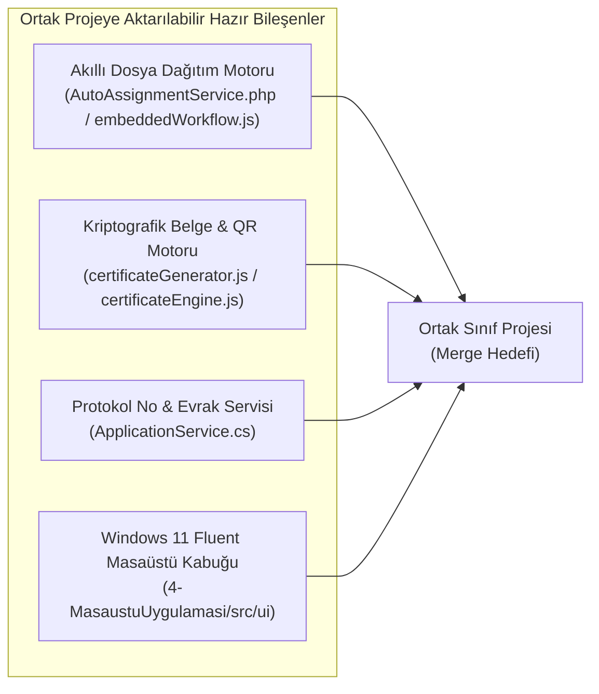

# 🏛️ Etik Kurul Otomasyon Sistemi (Ethics Committee Automation System)

> **Selçuk Üniversitesi Teknoloji Fakültesi Bilgisayar Mühendisliği Bölümü (İ.Ö.)**  
> **Ders:** Bilgisayar Mühendisliği Uygulamaları  
> **Geliştirici:** Mehmet Akif Ürey (233311066)  
> **Tarih / Sürüm:** Ekim 2026 / v1.1.0  
> **Vize (Ara Sınav) Kontrol Tarihi:** 27 Ekim 2026 Salı  
> **GitHub Deposu:** [https://github.com/Mehmet-Akiff/EtikKurulOtomasyonu](https://github.com/Mehmet-Akiff/EtikKurulOtomasyonu)

[](https://dotnet.microsoft.com/)
[](https://www.php.net/)
[](https://nodejs.org/)
[](https://www.electronjs.org/)
[](#-test-ve-kalite-güvencesi)
[](LICENSE)

---

## 📌 Proje Başlığı ve Kısa Özeti

**Etik Kurul Otomasyonu**; üniversiteler, enstitüler ve araştırma merkezlerinde yürütülen akademik araştırmalar, lisansüstü tezler (Yüksek Lisans / Doktora) ve kurumsal/TÜBİTAK projeleri için etik kurul onay süreçlerini baştan sona dijitalleştiren **çok katmanlı hibrit bir otomasyon sistemidir**.

### Çözülen Temel Problemler
- **Kağıtsız Başvuru ve Evrak Kaybının Önlenmesi:** Araştırmacıların başvuru formlarını ve ek belgelerini (Araştırma Protokolü, Bilgilendirilmiş Gönüllü Onam Formu, Veri Toplama Ölçekleri) fiziksel çıktı ve kargo gerekmeksizin dijital olarak iletmesi.
- **Akıllı ve Adil Dosya Dağıtımı:** Başvuruların kurul raportörlerine rastgele değil, araştırmanın uzmanlık alanı (Tıp, Psikoloji, Hukuk, Yapay Zeka vb.) ve üyelerin anlık aktif dosya yükü dengesine göre otomatik atanması.
- **Standartlaştırılmış Çok Kriterli Puanlama:** Raportörlerin 1–5 ölçeğinde yapılandırılmış kriterler (Metodoloji Uygunluğu, Onam Formu Şeffaflığı, Risk-Fayda Dengesi) üzerinden görüş bildirmesi.
- **Otomatik Karar Belgesi ve Kriptografik Doğrulama:** Kurul kararı çıktığı anda sistemin 24 haneli SHA-256 tuzlu doğrulama kodu ve gömülü dinamik Karekod (QR Kod) içeren resmi karar belgesini otomatik oluşturması; belgenin orijinalliğinin her an sorgulanabilmesi.

---

## 🛠️ Teknoloji Yığını (Tech Stack)

Proje, gereksinimler doğrultusunda **birbirinden tamamen bağımsız 3 arka uç (backend) mikroservisi** ve tüm bu servisleri sıfır kurulumla yerelde çalıştırabilen **1 masaüstü istemcisi** olarak inşa edilmiştir:

| Katman / Modül | Dil / Çalışma Zamanı | Framework / Kütüphaneler | Veritabanı & Kalıcılık | Bağlantı Noktası (Port) |
|---|---|---|---|---|
| **Modül 1: Başvuru & Evrak** | C# (.NET 9.0) | ASP.NET Core Web API, EF Core 9.0 | Microsoft SQL Server (MSSQL) + SQLite / In-Memory Fallback | `http://localhost:5001` |
| **Modül 2: Atama & Değerlendirme** | PHP 8.3+ | Katmanlı MVC Mimarisi, PDO, Bootstrap 5 | MySQL 8.x + SQLite Fallback (`PDO_SQLITE`) | `http://localhost:5002` |
| **Modül 3: Karar & Belge** | Node.js (v20+) | Express.js 4.21, Mongoose 8.9, QRCode 1.5, CORS | MongoDB NoSQL Doküman + In-Memory Fallback | `http://localhost:5003` |
| **Modül 4: Masaüstü İstemcisi** | JavaScript (ES6+) | Electron 34, Windows 11 Fluent UI, HTML5/CSS3 | Yerel Kalıcı JSON Mağazası (`AppData/Roaming/...`) | Masaüstü `.exe` |
| **Birim & Entegrasyon Testleri** | C#, PHP, JS | xUnit, PHP CLI Test Harness, Node Test Runner | SQLite In-Memory / Geçici Depolama | CI / Terminal |

---

## 📂 Mimari ve Klasör Yapısı

Proje dosyaları kesin çizgilerle modüler olarak ayrılmış olup, herhangi bir modüldeki kod diğerinin içine karışmaz:

```
EtikKurulOtomasyonu/
│
├── 1-BasvuruModulu_DotNet/            # [Modül 1] ASP.NET Core 9 Web API + MSSQL
│   ├── Controllers/                   # REST API uç noktaları (Applications, Researchers)
│   ├── Data/                          # EF Core DbContext ve veritabanı tohumlayıcı (Seeder)
│   ├── DTOs/                          # Request / Response veri transfer nesneleri
│   ├── Models/                        # Application, Researcher, ApplicationDocument, Status
│   ├── Services/                      # ApplicationService (Protokol no üretici, SHA-256 evrak kaydı)
│   ├── EtikKurul.BasvuruModulu.csproj # .NET 9 proje yapılandırması ve bağımlılıklar
│   └── Program.cs                     # API giriş noktası ve Bağımlılık Enjeksiyonu (DI)
│
├── 1-BasvuruModulu_DotNet.Tests/      # Modül 1 xUnit Birim ve Doğrulama Testleri
│   └── ApplicationServiceTests.cs     # 4/4 Başarılı xUnit test senaryosu
│
├── 2-DegerlendirmeModulu_PHP/         # [Modül 2] PHP 8.3 + MySQL Atama ve İnceleme Servisi
│   ├── config/                        # database.php (MySQL PDO bağlantısı ve SQLite yedeği)
│   ├── controllers/                   # AssignmentController, EvaluationController
│   ├── database/                      # schema.sql (MySQL ilişkisel tabloları ve örnek üyeler)
│   ├── models/                        # CommitteeMember, Assignment, Evaluation modelleri
│   ├── services/                      # AutoAssignmentService (Akıllı Raportör Dağıtım Algoritması)
│   ├── views/                         # evaluation_form.html (Kurul Üyesi Web Değerlendirme Portalı)
│   ├── tests/                         # AutoAssignmentTest.php (4/4 Başarılı PHP birim testi)
│   └── index.php                      # REST API ve Web Portalı Yönlendiricisi (Router)
│
├── 3-KararVeBelgeModulu_Node/         # [Modül 3] Node.js Express + MongoDB Karar Servisi
│   ├── src/config/                    # db.js (MongoDB bağlantısı ve In-Memory Mock Fallback)
│   ├── src/controllers/               # decisionController.js, revisionController.js
│   ├── src/models/                    # Decision.js, RevisionRequest.js, AuditLog.js
│   ├── src/routes/                    # apiRoutes.js (REST API yönlendirmeleri)
│   ├── src/services/                  # decisionService.js, certificateGenerator.js (QR Kod Motoru)
│   ├── src/server.js                  # Express sunucusu başlatıcı
│   └── tests/                         # decision.test.js (4/4 Başarılı Node.js entegrasyon testi)
│
├── 4-MasaustuUygulamasi/              # [Modül 4] Windows 11 Fluent UI Masaüstü Uygulaması
│   ├── dist/                          # Üretilen çalıştırılabilir paketler (.exe)
│   │   ├── Etik Kurul Otomasyonu Setup 1.0.0.exe  # Standart Windows Kurulum Paketi
│   │   ├── EtikKurulOtomasyonu-Portable.exe       # Kurulumsuz Taşınabilir Tek Exe
│   │   └── win-unpacked/                          # Paketlenmiş ham çalıştırılabilir dosyalar
│   ├── src/engine/                    # embeddedStore.js, embeddedWorkflow.js, certificateEngine.js
│   ├── src/ui/                        # index.html, app.js, styles.css (Windows 11 Fluent Tasarım)
│   ├── src/main.js                    # Electron Main Process (Güvenli IPC Yöneticisi)
│   ├── src/preload.js                 # contextBridge Güvenli Köprü Arayüzü
│   ├── tests/                         # engine.test.js (7/7 Başarılı Gömülü Motor Testi)
│   └── package.json                   # Electron ve electron-builder derleme yapılandırması
│
├── docs/                              # Sistem Diyagramları, Grafikler ve Canlı Ekran Görüntüleri
│   ├── charts/                        # Matplotlib ile üretilen 4 teknik mimari grafiği
│   └── screenshots/                   # Çalışan masaüstü uygulamasından alınan 7 gerçek ekran görüntüsü
│
├── scripts/                           # Rapor ve ekran görüntüsü üretim otomasyonları
│   └── generate_report.py             # Akademik Word (.docx) raporu üretici
│
├── Baslat.bat                         # Masaüstü uygulamasını çift tıkla doğrudan başlatan betik
├── start-all.ps1                      # 3 arka uç servisini (5001, 5002, 5003) tek komutla başlatan betik
├── test-workflow.ps1                  # 4 modülün 19 testini tek komutla doğrulayan test betiği
├── docker-compose.yml                 # MSSQL, MySQL, MongoDB ve API'leri kapsayan Docker Compose
├── README.md                          # Bu doküman (Ortak Proje & GitHub Kılavuzu)
├── TEKNIK_ILERLEME_RAPORU.md          # Danışman Hoca & Vize Değerlendirme Raporu
└── ENTEGRASYON_REHBERI.md             # Sınıf İçi Görev Paylaşımı ve Merge Kontrol Listesi
```

---

## 🚀 Tamamlanan Özellikler ve Modüller

Sistemde şu an aktif olarak çalışan ve birbiriyle senkronize olan tüm işlevler aşağıda özetlenmiştir:

### 1. Sistem Genel Bakış (Dashboard)
- **Canlı İstatistik Kartları:** Toplam Başvuru, İncelemede/Bekleyen Dosyalar, Onaylanan Kararlar ve Aktif Kurul Üyesi sayılarını anlık gösterir.
- **Süreç Takip Tablosu:** Tüm başvuruları protokol numarası, proje başlığı, araştırmacı, uzmanlık alanı, renkli durum rozeti (`Başvuruldu`, `İncelemede`, `Düzeltme İsteniyor`, `ONAYLANDI`, `REDDEDİLDİ`) ve başvuru tarihine göre listeler.
- **Hızlı İşlem Butonları:** Başvurunun durumuna göre tek tıkla doğrudan ilgili işleme yönlendirir (*Raportör Ata*, *Değerlendir*, *Karar Belgesi*).

### 2. Yeni Başvuru ve Araştırmacı Yönetimi
- **Dinamik Başvuru Formu:** Araştırma türü (Akademik Araştırma, Tez, TÜBİTAK Projesi vb.), araştırma alanı, katılımcı sayısı, risk seviyesi (Düşük, Orta, Yüksek), özet ve metodoloji giriş alanları.
- **Otomatik Protokol Numarası:** Sisteme gönderilen her başvuruya `ETIK-YYYY-XXXXX` formatında sıralı ve benzersiz protokol numarası tahsis edilir (Örn: `ETIK-2026-00001`).
- **Satır İçi Hızlı Araştırmacı Ekleme:** Sorumlu araştırmacı kutusunun yanında yer alan panel ile formdan ayrılmadan anında yeni araştırmacı tanımlanabilir.
- **Dijital Evrak İletimi:** Araştırma Protokolü, Bilgilendirilmiş Onam Formu ve Veri Toplama Ölçekleri otomatik bağlanır ve SHA-256 özetiyle saklanır.

### 3. Akıllı Otomatik Dosya Dağıtımı
- **Uzmanlık Alanı Eşleşmesi:** Başvurunun araştırma alanı ile kurul raportörlerinin uzmanlık alanlarını Türkçe karakter duyarlı kelime analiziyle eşleştirir.
- **Yük Dengeleme Algoritması:** Raportörlerin aktif dosya sayılarını hesaba katarak en uygun 2 üyeyi otomatik atar:
  $$\text{Aday Skoru} = (\text{Uzmanlık Eşleşmesi} \times 100) - (\text{Aktif Dosya Yükü} \times 10)$$
- **Atanmış Dosyalar Tablosu:** Raportör atanan başvuruların kaç raportör tarafından değerlendirildiğini anlık olarak gösterir (*"1 / 2 Değerlendirildi"*).

### 4. Kurul Üyesi Değerlendirme & Puanlama
- **3 Temel Etik Kriter Puanlaması (1 - 5 Ölçeği):**
  1. *Araştırma Yöntemi ve Metodoloji Uygunluğu* (Gönüllü güvenliği ve bilimsel ilkeler)
  2. *Bilgilendirilmiş Onam ve Gönüllü Hakları* (Aydınlatma metni yeterliliği)
  3. *Risk ve Fayda Analizi Değerlendirmesi* (Risklerin minimize edilmesi)
- **Görüş ve Karar Bildirimi:** Raportörün `Onay`, `Revizyon` veya `Ret` tercihi ile gerekçe notu kaydı.
- **Tamamlanan Değerlendirmeler Tablosu:** Kurul üyelerinin verdikleri puanları ($M / O / R$), ortalamalarını ve görüş notlarını kronolojik olarak listeler.

### 5. Karar & Resmi Karar Belgesi (HTML + QR)
- **Otomatik Karar Kesinleştirme:** Raportör onayı sisteme girildiği anda karar kaydı ve resmi belge anında üretilir. İkinci raportör oy verdiğinde karar numarası korunarak belge 2 imza ile güncellenir.
- **Kriptografik 24 Haneli Kod:** Her karar için protokol ve karar numaralarından türetilen SHA-256 tabanlı güvenli doğrulama kodu üretilir (Örn: `0EBBEF2723BABD448543942C`).
- **Dinamik Karekod (QR Kod):** Resmi belgenin sağ alt köşesine doğrulama kodunu içeren taranabilir QR kod otomatik gömülür.
- **Revizyon Onaylama & Doğrudan Kurul Kararı:** Revizyon verilmiş veya incelemedeki başvurular için doğrudan kurul başkanlığı kararı (*Onayla*, *Revizyon*, *Reddet*) verilebilir.

### 6. Belge Doğrulama Portalı
- Belge üzerindeki 24 haneli kod girilerek veya sistemde kayıtlı karar etiketlerine tek tıkla basılarak belgenin geçerliliği, karar sonucu, araştırmacı ve onay tarihi anında doğrulanabilir.

---

## 🌟 Ortak Projeye Aktarılmaya Hazır Güçlü Modüller

Diğer proje gruplarının ortak ana projede doğrudan kullanabileceği, bağımsız çalışabilirliği yüksek bileşenler:



1. **Akıllı Otomatik Raportör Atama Motoru**
   - **Dosya:** [`2-DegerlendirmeModulu_PHP/services/AutoAssignmentService.php`](file:///C:/Users/PC/Desktop/Antigravity%20Projects/EtikKurulOtomasyonu/2-DegerlendirmeModulu_PHP/services/AutoAssignmentService.php) ve [`4-MasaustuUygulamasi/src/engine/embeddedWorkflow.js`](file:///C:/Users/PC/Desktop/Antigravity%20Projects/EtikKurulOtomasyonu/4-MasaustuUygulamasi/src/engine/embeddedWorkflow.js)
   - **Neden Güçlü?:** Uzmanlık alanını Türkçe doğal dil durak kelimelerinden arındırır (`tokenizeField`), yük dengesi formülüyle jüri üyelerini sıralar ve idempotent (tekrar atamayı engelleyen) çalışır.
2. **Kriptografik Doğrulama Kodu ve QR Kodlu Karar Belgesi Motoru**
   - **Dosya:** [`3-KararVeBelgeModulu_Node/src/services/certificateGenerator.js`](file:///C:/Users/PC/Desktop/Antigravity%20Projects/EtikKurulOtomasyonu/3-KararVeBelgeModulu_Node/src/services/certificateGenerator.js) ve [`4-MasaustuUygulamasi/src/engine/certificateEngine.js`](file:///C:/Users/PC/Desktop/Antigravity%20Projects/EtikKurulOtomasyonu/4-MasaustuUygulamasi/src/engine/certificateEngine.js)
   - **Neden Güçlü?:** Resmi üniversite rektörlüğü anteti, kurul başkanı/üye imzaları, 24 haneli SHA-256 doğrulama kodu ve Base64 QR kodunu tek çağrıda bağımsız bir HTML/PDF çıktısına dönüştürür.
3. **Formatlı Başvuru Protokol No Üreticisi ve Durum Yönetimi**
   - **Dosya:** [`1-BasvuruModulu_DotNet/Services/ApplicationService.cs`](file:///C:/Users/PC/Desktop/Antigravity%20Projects/EtikKurulOtomasyonu/1-BasvuruModulu_DotNet/Services/ApplicationService.cs)
   - **Neden Güçlü?:** Yıl bazlı çakışmasız `ETIK-YYYY-XXXXX` serisi üretir; `Draft`, `Submitted`, `UnderReview`, `RevisionRequested`, `Approved`, `Rejected` geçişlerini doğrular.
4. **Taşınabilir Windows Masaüstü Arayüzü (Fluent UI)**
   - **Dosya:** [`4-MasaustuUygulamasi/src/ui/`](file:///C:/Users/PC/Desktop/Antigravity%20Projects/EtikKurulOtomasyonu/4-MasaustuUygulamasi/src/ui/)
   - **Neden Güçlü?:** Herhangi bir web framework'üne (React, Vue vb.) ihtiyaç duymadan saf HTML5/CSS3/Vanilla JS ile yüksek performanslı, duyarlı ve Windows 11 Fluent tasarımına sahip 6 sekmeli arayüz sunar.

---

## ⚡ Kurulum ve Çalıştırma (Quick Start)

### Yöntem A: Masaüstü Uygulamasını Tek Tıkla Başlatma (Önerilen)

Projeyi test etmek için hiçbir veritabanı veya derleyici kurmanıza gerek yoktur:

1. Proje kök dizinindeki [`Baslat.bat`](file:///C:/Users/PC/Desktop/Antigravity%20Projects/EtikKurulOtomasyonu/Baslat.bat) dosyasına çift tıklayın.
2. Veya doğrudan kurulumsuz taşınabilir dosyayı çalıştırın:  
   `4-MasaustuUygulamasi/dist/EtikKurulOtomasyonu-Portable.exe`
3. Standart kurulum tercih edilirse:  
   `4-MasaustuUygulamasi/dist/Etik Kurul Otomasyonu Setup 1.0.0.exe`

### Yöntem B: Tüm Mikroservisleri Yerelde Başlatma (PowerShell)

Geliştirme amacıyla her 3 arka uç servisini bağımsız konsollarda ayağa kaldırmak için:

```powershell
# Proje kök dizininde:
.\start-all.ps1
```

Bu komut sırasıyla şu servisleri başlatır:
- **Modül 1 (ASP.NET Core 9 API):** `http://localhost:5001/api/applications`
- **Modül 2 (PHP 8.3 Değerlendirme Portalı):** `http://localhost:5002`
- **Modül 3 (Node.js Karar ve Doğrulama Servisi):** `http://localhost:5003`

### Yöntem C: Bağımsız Modül Komutları

Her bir modülü kendi dizininde manuel çalıştırmak isterseniz:

```bash
# 1. Modül (ASP.NET Core)
cd 1-BasvuruModulu_DotNet
dotnet run --urls http://localhost:5001

# 2. Modül (PHP)
cd 2-DegerlendirmeModulu_PHP
php -S localhost:5002 index.php

# 3. Modül (Node.js)
cd 3-KararVeBelgeModulu_Node
npm install
node src/server.js

# 4. Modül (Electron Masaüstü)
cd 4-MasaustuUygulamasi
npm install
npm start
```

### Yöntem D: Docker Compose ile Konteyner Başlatma

Veritabanları (MSSQL, MySQL, MongoDB) ve mikroservisleri tam yalıtımlı çalıştırmak için:

```bash
docker-compose up -d
```

---

## 🧪 Test ve Kalite Güvencesi

Projedeki tüm iş kuralları ve algoritmalar 4 bağımsız test paketi ile doğrulanmıştır:

```powershell
# Tek komutla 19 testin tamamını çalıştırmak için:
.\test-workflow.ps1
```

```
======================================================================
🏛️  ETİK KURUL OTOMASYONU - UÇTAN UCA İŞ AKIŞI DOĞRULAMA TESTİ
======================================================================

[AŞAMA 1] Modül 1 (ASP.NET Core 9 + MSSQL) Test Ediliyor...
✅ Modül 1 Başarılı: Başvuru kayıt, belge yükleme ve protokol üretim testleri geçti (4/4).

[AŞAMA 2] Modül 2 (PHP + MySQL) Test Ediliyor...
✅ Modül 2 Başarılı: Akıllı otomatik dosya atama ve üye değerlendirme testleri geçti (4/4).

[AŞAMA 3] Modül 3 (Node.js + MongoDB) Test Ediliyor...
✅ Modül 3 Başarılı: Karar kesinleştirme, QR kodlu karar belgesi üretimi ve doğrulama testleri geçti (4/4).

[AŞAMA 4] Modül 4 (Masaüstü Uygulaması Gömülü Motoru) Test Ediliyor...
✅ Modül 4 Başarılı: Masaüstü uçtan uca başvuru, atama, değerlendirme ve karar senkronizasyon testleri geçti (7/7).

======================================================================
🎉 TÜM MODÜLLER VE İŞLEVSEL GEREKSİNİMLER %100 BAŞARIYLA DOĞRULANDI! (19/19)
======================================================================
```

---

## 👥 İletişim ve Destek

- **Geliştirici:** Mehmet Akif Ürey (Öğrenci No: 233311066)  
- **Bölüm:** Selçuk Üniversitesi Teknoloji Fakültesi Bilgisayar Mühendisliği Bölümü (İ.Ö.)  
- **Ders:** Bilgisayar Mühendisliği Uygulamaları  
- **Sorular / Entegrasyon İletişimi:** GitHub Issues veya ders çalışma grupları üzerinden iletişime geçebilirsiniz.
