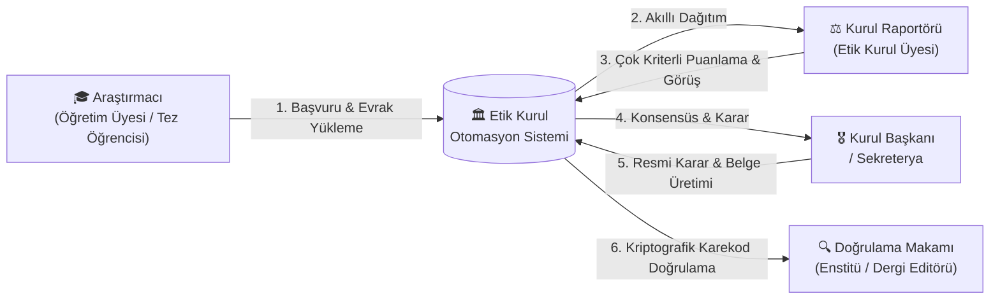
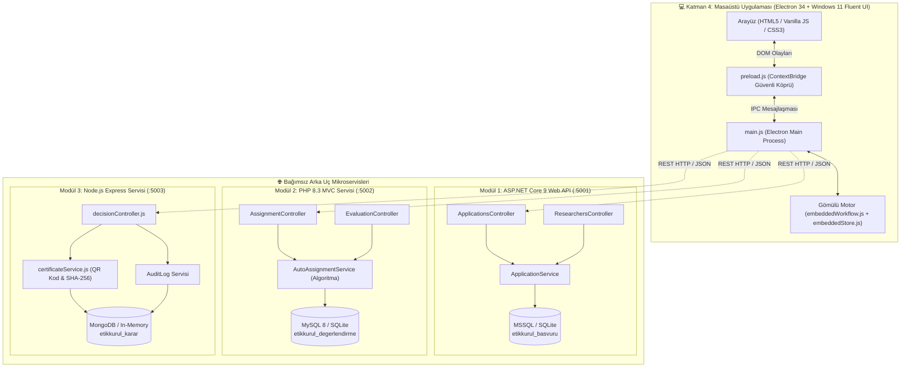
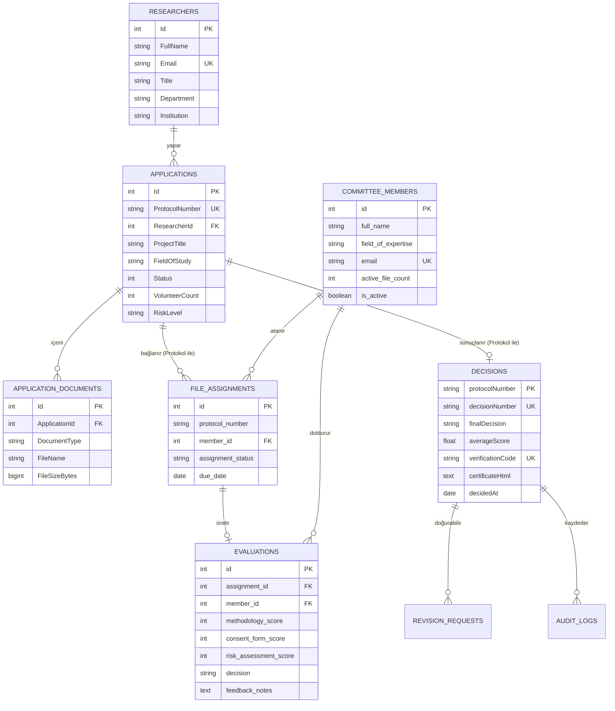
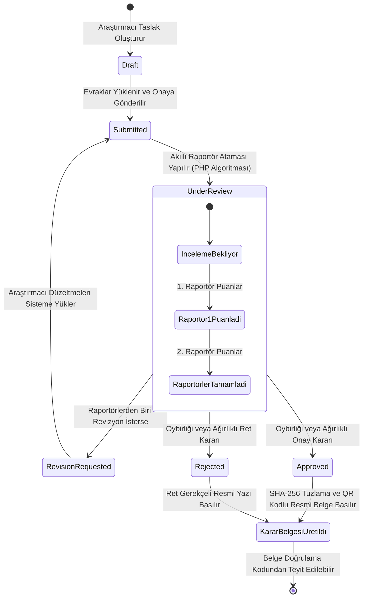

# 🏛️ ÇOK KATMANLI HİBRİT ETİK KURUL ONAY VE KARAR OTOMASYON SİSTEMİ
## BİLGİSAYAR MÜHENDİSLİĞİ UYGULAMALARI DERSİ — TEKNİK İLERLEME VE ARA SINAV (VİZE) RAPORU

---

### 📋 RAPOR ÜST BİLGİLERİ (METADATA)

| Parametre | Değer / Açıklama |
|---|---|
| **T.C. Üniversite / Fakülte** | Selçuk Üniversitesi Teknoloji Fakültesi |
| **Akademik Bölüm** | Bilgisayar Mühendisliği Bölümü (İkinci Öğretim) |
| **Dersin Adı ve Kodu** | Bilgisayar Mühendisliği Uygulamaları |
| **Proje Adı** | Akademik ve Kurumsal Araştırmalar İçin Çok Katmanlı Hibrit Etik Kurul Otomasyon Sistemi |
| **Öğrenci Adı Soyadı** | Mehmet Akif Ürey |
| **Öğrenci Numarası** | 233311066 |
| **Dönem / Değerlendirme** | 2026–2027 Güz Yarıyılı / Ara Sınav (Vize) İlerleme Raporu |
| **Vize Kontrol Tarihi** | 27 Ekim 2026 Salı |
| **Proje Sürümü** | v1.1.0-stable (Production Ready) |
| **Açık Kaynak Kod Deposu** | [https://github.com/Mehmet-Akiff/EtikKurulOtomasyonu](https://github.com/Mehmet-Akiff/EtikKurulOtomasyonu) |
| **Doğrulanan Test Başarısı** | 19 / 19 Başarılı Test (%100 Başarı Oranı) |

---

## 📑 İÇİNDEKİLER

1. [Proje Tanımı, Amaç ve Çözülen Problem](#1-proje-tanımı-amaç-ve-çözülen-problem)
2. [Sistem Mimarisi ve Tasarım Kararları](#2-sistem-mimarisi-ve-tasarım-kararları)
3. [Veritabanı Mimarisi ve Veri Modeli](#3-veritabanı-mimarisi-ve-veri-modeli)
4. [Geliştirilen Modüller ve İş Akışları (Workflows)](#4-geliştirilen-modüller-ve-iş-akışları-workflows)
5. [Test, Doğrulama ve Kalite Güvencesi](#5-test-doğrulama-ve-kalite-güvencesi)
6. [Ortak Proje Birleştirme (Entegrasyon) Uyumluluğu](#6-ortak-proje-birleştirme-entegrasyon-uyumluluğu)
7. [Sonuç ve Genel Değerlendirme](#7-sonuç-ve-genel-değerlendirme)

---

## 1. PROJE TANIMI, AMAÇ VE ÇÖZÜLEN PROBLEM

### 1.1. Akademik ve Kurumsal Arka Plan
Üniversitelerde, araştırma hastanelerinde ve bilimsel enstitülerde insanlar, hayvanlar, kişisel veriler veya biyolojik materyaller üzerinde yürütülecek her türlü akademik araştırma (Yüksek Lisans/Doktora tezleri, TÜBİTAK/BAP projeleri, klinik ve anket çalışmaları), ulusal ve uluslararası regülasyonlar (Helsinki Bildirgesi, KVKK, Üniversite Etik Kurul Yönergeleri) uyarınca **Etik Kurul Onayına** tabidir.

Geleneksel üniversite işleyişinde etik kurul süreçleri genellikle şu aksaklıklarla yürütülmektedir:
- **Fiziksel Evrak Yükü ve Kayıplar:** Islak imzalı başvuru formları, onam dilekçeleri ve protokol dosyalarının elden teslim edilmesi sırasında yaşanan gecikmeler, kayıplar ve kargo masrafları.
- **Rastgele / Dengesiz Dosya Dağıtımı:** Kurul raportörlerine (hakemlere) dosyaların uzmanlık alanları (Örn: Tıp, Sosyal Bilimler, Hukuk, Mühendislik) ve mevcut iş yükleri gözetilmeksizin manuel veya tesadüfi dağıtılması; bunun neticesinde hakem başına düşen iş yükü asimetrisi ve inceleme sürelerinin aylarca uzaması.
- **Şeffaf Olmayan Değerlendirme Kriterleri:** İnceleme raporlarının serbest metin olarak yazılması nedeniyle standardizasyonun bozulması, eksikliklerin araştırmacıya geç veya muğlak aktarılması.
- **Karar Belgesi Sahteciliği ve Doğrulanamazlık:** Çıkan onay/ret yazılarının sadece kağıt üzerinde ıslak imza/mühürle verilmesi; dijital platformlarda veya bilimsel dergi süreçlerinde belgenin gerçekliğinin anında teyit edilememesi.

### 1.2. Otomasyon Sisteminin Hedefleri
Bu proje; yukarıda sıralanan darboğazları ortadan kaldırmak amacıyla, **dört katmanlı hibrit bir mimari** ile şu hedefleri gerçekleştirmek üzere tasarlanmıştır:
1. **Uçtan Uca Dijital Başvuru:** Araştırmacıların kuruma gitmeden projelerini, araştırma ölçeklerini ve Bilgilendirilmiş Gönüllü Onam Formlarını dijital sisteme yüklemesi.
2. **Akıllı Raportör Atama Motoru:** Dosyanın çalışma alanına göre en uygun uzmanlık puanına sahip ve aktif dosya yükü en az olan kurul üyelerine otomatik ve adil dağıtılması.
3. **Standartlaştırılmış Çok Kriterli Puanlama:** Raportörlerin metodoloji, onam şeffaflığı ve risk parametrelerini 1-5 ölçeğinde değerlendirerek sistem üzerinden gerekçelendirmesi.
4. **Otomatik Karar Belgesi ve Kriptografik Doğrulama:** Oylama ve puanların konsolidasyonu ile kurul kararı çıktığı anda, SHA-256 tuzlu hash algoritması ve dinamik Karekod (QR Kod) içeren resmi etik kurul belgesinin otomatik olarak HTML/PDF formatında üretilmesi ve harici doğrulama portalından doğrulanabilmesi.

### 1.3. Sistem Aktörleri ve Roller



---

## 2. SİSTEM MİMARİSİ VE TASARIM KARARLARI

### 2.1. Seçilen Mimari Yapı: 4 Katmanlı Hibrit Mikroservis Modeli
Ders yürütücüsünün şartnamesinde belirtilen 3 temel teknoloji grubu (`ASP.NET Core + MSSQL`, `PHP + MySQL`, `Node.js + MongoDB`) gereksinimini monolitik bir karmaşaya sokmak yerine, **Sorumlulukların Ayrılığı (Separation of Concerns - SoC)** prensibine tam sadık kalarak her teknolojinin en güçlü olduğu alanı bir mikroservise dönüştüren 4 katmanlı hibrit bir mimari kurgulanmıştır:

1. **Katman 1 (ASP.NET Core 9.0 Web API):** Başvuru yönetimi, kurumsal araştırmacı kimlikleri, evrak meta verileri ve `ETIK-YYYY-XXXXX` formatlı benzersiz protokol numarası üretimi.
2. **Katman 2 (PHP 8.3 MVC):** Kurul üye havuzu, akıllı uzmanlık eşleştirme algoritması, iş yükü dengeleme motoru ve raportör değerlendirme formu.
3. **Katman 3 (Node.js Express + MongoDB):** Raportör oylarının konsolidasyonu, revizyon döngüleri, SHA-256 kriptografik doğrulama kodu, dinamik SVG/PNG QR kod üretimi ve denetim izi (Audit Log) mekanizması.
4. **Katman 4 (Electron 34 + Fluent UI):** Windows işletim sisteminde bağımsız çalışabilen, hem 3 mikroservisi REST üzerinden orkestre edebilen hem de gömülü motoru (`EmbeddedWorkflow`, `EmbeddedStore`) sayesinde sıfır bağımlılıkla yerelde çalışabilen masaüstü platformu.

### 2.2. Katmanlar Arası Mimari Blok Diyagramı



### 2.3. Temel Tasarım Kararları ve Güvenlik Yaklaşımları
- **Çift Katmanlı Kalıcılık ve Kesintisiz Fallback (High Availability):**
  - Modül 1: MSSQL bağlantısı başarısız olursa otomatik olarak SQLite (`etikkurul_basvuru.db`) veya In-Memory veritabanına geçer.
  - Modül 2: MySQL sunucusu yoksa otomatik olarak yerel SQLite (`database/evaluation.sqlite`) sürücüsünü devreye sokar.
  - Modül 3: MongoDB bağlantı hatasında sistem kilitlenmez, bellek içi (In-Memory) nesne saklayıcıya geçerek çalışmasını sürdürür.
  - Modül 4: Hiçbir servis veya Docker çalışmasa bile `AppData/Roaming/etik-kurul-otomasyonu/etikkurul_local.json` üzerinden tam fonksiyonel yerel motor devreye girer.
- **İçerik Güvenliği ve Süreç İzolasyonu:**
  - Masaüstü uygulamasında Electron `nodeIntegration: false` ve `contextIsolation: true` ile çalıştırılmıştır. Arayüzün işletim sistemi çağrılarına doğrudan erişimi engellenmiş, tüm veri trafiği güvenli `contextBridge` üzerinden IPC ile sınırlandırılmıştır.
- **Kriptografik Bütünlük ve Sahtecilik Koruması:**
  - Resmi karar belgesi oluşturulurken protokol numarası, karar tarihi, proje adı ve gizli bir tuz (salt) anahtarı SHA-256 algoritmasından geçirilerek 24 karakterlik büyük harfli hex formatında bir doğrulama kodu türetilir. Bu kod harici `verify` uç noktasından doğrulanmadığı sürece belge sahte kabul edilir.

---

## 3. VERİTABANI MİMARİSİ VE VERİ MODELİ

Sistemde her mikroservisin kendi sorumluluk alanına ait ilişkisel veya doküman tabanlı veri modelleri bulunmaktadır.

### 3.1. Modül 1 Veritabanı Şeması (ASP.NET Core + MSSQL/SQLite)
- **`Researchers` Tablosu:**
  - `Id` (INT, PK, Identity): Araştırmacı benzersiz kimliği.
  - `FullName` (NVARCHAR(150), Not Null): Araştırmacı unvan, ad ve soyadı.
  - `Email` (NVARCHAR(150), Not Null, Unique): Kurumsal e-posta adresi.
  - `Title` (NVARCHAR(50)): Prof. Dr., Doç. Dr., Dr. Öğr. Üyesi vb.
  - `Department` (NVARCHAR(150)): Bölüm (Örn: Bilgisayar Mühendisliği).
  - `Institution` (NVARCHAR(200)): Üniversite / Enstitü bilgisi.
  - `PhoneNumber` (NVARCHAR(30)): İletişim telefonu.
  - `CreatedAt` (DATETIME2): Kayıt zamanı.
- **`Applications` Tablosu:**
  - `Id` (INT, PK, Identity): Başvuru ID.
  - `ProtocolNumber` (NVARCHAR(50), Not Null, Unique): `ETIK-YYYY-XXXXX` formatlı resmi protokol numarası.
  - `ResearcherId` (INT, FK -> Researchers.Id): Başvuran araştırmacı referansı.
  - `ProjectTitle` (NVARCHAR(300), Not Null): Araştırma/Tez başlığı.
  - `ResearchType` (NVARCHAR(100)): Tez, Akademik Araştırma, Kurumsal Proje.
  - `FieldOfStudy` (NVARCHAR(100)): Tıp, Sosyal Bilimler, Mühendislik, Biyomedikal vb.
  - `Abstract` (NVARCHAR(MAX)): Araştırma özeti ve amacı.
  - `Methodology` (NVARCHAR(MAX)): Kullanılacak veri toplama ve analiz metodolojisi.
  - `TargetAudience` (NVARCHAR(200)): Denek / katılımcı profili.
  - `VolunteerCount` (INT): Öngörülen gönüllü sayısı.
  - `RiskLevel` (NVARCHAR(20)): Düşük, Orta, Yüksek.
  - `Status` (INT Enum): 0: Draft, 1: Submitted, 2: UnderReview, 3: RevisionRequested, 4: Approved, 5: Rejected.
  - `SubmittedAt` (DATETIME2, Nullable): Kurula sunulma anı.
- **`ApplicationDocuments` Tablosu:**
  - `Id` (INT, PK): Belge ID.
  - `ApplicationId` (INT, FK -> Applications.Id): İlgili başvuru.
  - `DocumentType` (NVARCHAR(100)): Onam Formu, Araştırma Protokolü, Ölçek/Anket Formu.
  - `FileName` (NVARCHAR(255)): Dosya adı.
  - `StoredFilePath` (NVARCHAR(500)): Fiziksel/sanal saklama yolu.
  - `FileSizeBytes` (BIGINT): Bayt cinsinden boyut.

### 3.2. Modül 2 Veritabanı Şeması (PHP + MySQL/SQLite)
- **`committee_members` Tablosu:**
  - `id` (INT, PK, Auto Increment): Kurul üye ID.
  - `full_name` (VARCHAR(150), Not Null): Üye adı soyadı.
  - `title` (VARCHAR(100)): Akademik unvan.
  - `field_of_expertise` (VARCHAR(100)): Uzmanlık alanı (Tıp, Klinik Psikoloji, Hukuk, Mühendislik vb.).
  - `email` (VARCHAR(150), Unique): Kurumsal iletişim.
  - `active_file_count` (INT, Default 0): Üyenin üzerinde henüz tamamlanmamış aktif inceleme dosya sayısı.
  - `is_active` (TINYINT(1), Default 1): Üyenin faal durumu.
- **`file_assignments` Tablosu:**
  - `id` (INT, PK, Auto Increment): Atama kaydı ID.
  - `protocol_number` (VARCHAR(50), Not Null): Modül 1'den gelen başvuru protokol no.
  - `project_title` (VARCHAR(300)): Proje adı.
  - `field_of_study` (VARCHAR(100)): Araştırma konusu.
  - `member_id` (INT, FK -> committee_members.id): Görevlendirilen üye.
  - `assignment_status` (ENUM('Pending', 'InReview', 'Completed')): İnceleme durumu.
  - `due_date` (DATE): Raporlama son teslim tarihi (varsayılan: +14 gün).
- **`evaluations` Tablosu:**
  - `id` (INT, PK, Auto Increment): İnceleme raporu ID.
  - `assignment_id` (INT, FK -> file_assignments.id): Atama referansı.
  - `protocol_number` (VARCHAR(50)): Başvuru protokolü.
  - `member_id` (INT, FK -> committee_members.id): Değerlendiren üye.
  - `methodology_score` (INT, 1-5): Bilimsel yöntem uygunluk puanı.
  - `consent_form_score` (INT, 1-5): Bilgilendirilmiş onam formu şeffaflık puanı.
  - `risk_assessment_score` (INT, 1-5): Risk-Fayda analizi puanı.
  - `decision` (ENUM('Approved', 'RevisionNeeded', 'Rejected')): Üye nihai görüşü.
  - `feedback_notes` (TEXT): Ayrıntılı hakem gerekçe notu.

### 3.3. Modül 3 NoSQL Koleksiyon Şeması (Node.js + MongoDB)
- **`decisions` Koleksiyonu (Mongoose Schema):**
  - `protocolNumber` (String, Unique, Index): Başvuru protokolü.
  - `decisionNumber` (String, Unique): `KARAR-YYYY-XXXXX` formatlı resmi karar sayısı.
  - `projectTitle` (String): Proje adı.
  - `researcherName` (String): Yürütücü araştırmacı.
  - `finalDecision` (String: Approved | RevisionNeeded | Rejected): Kurul nihai kararı.
  - `summaryRationale` (String): Kurul gerekçeli kararı.
  - `averageScore` (Number): Raportörlerin verdiği 3 ana kriterin genel aritmetik ortalaması (1.0 - 5.0).
  - `memberVotes` (Array): Raportörlerin bireysel oy ve puanlarını içeren alt doküman (sub-document) dizisi.
  - `verificationCode` (String, Unique): SHA-256 tabanlı 24 karakterlik kriptografik kod.
  - `certificateHtml` (String): Üretilen resmi A4 karar belgesinin HTML/CSS şablonu.
  - `decidedAt` (Date): Karar tarihi.
- **`revisionrequests` Koleksiyonu:**
  - `protocolNumber`, `cycle` (Döngü sayısı: 1, 2, ...), `requiredCorrections` (Talep edilen düzeltmeler), `deadline` (Son tarih), `status`.
- **`auditlogs` Koleksiyonu:**
  - `protocolNumber`, `action` (Başvuru, Atama, Oylama, Onay, Belge Üretimi), `actor`, `details`, `timestamp`.

### 3.4. Varlık-İlişki Diyagramı (Mermaid ER Diagram)



---

## 4. GELİŞTİRİLEN MODÜLLER VE İŞ AKIŞLARI (WORKFLOWS)

Sistemdeki iş mantığı (business logic), uçtan uca birbirini tetikleyen durum makineleri ve algoritmalarla çalışır.

### 4.1. Başvuru Yaşam Döngüsü ve Durum Makinesi



### 4.2. Somut Dosya ve Kod Bazında Modül İncelemeleri

#### 1) Modül 1 (.NET 9): Başvuru ve Evrak Servisi
- **Konum:** `1-BasvuruModulu_DotNet/`
- **Uç Noktalar:**
  - `POST /api/applications` (`ApplicationsController.cs#L42`): Yeni başvuru oluşturur.
  - `POST /api/applications/{id}/submit` (`ApplicationsController.cs#L79`): Başvuruyu `Draft` durumundan `Submitted` durumuna geçirir.
  - `POST /api/applications/{id}/documents` (`ApplicationsController.cs#L60`): Onam formu, araştırma protokolü vb. belgelerin meta verilerini kaydeder.
- **Protokol Numarası Üretim Algoritması (`ApplicationService.cs`):**
  Sistem her başvuru için `ETIK-{YIL}-{Rastgele/Sıralı 5 Haneli Kod}` biçiminde (Örn: `ETIK-2026-00001`) benzersiz bir takip numarası türetir. Bu numara, sistemler arası entegrasyonda **Evrensel Birincil Anahtar (Global Correlation ID)** olarak kullanılır.

#### 2) Modül 2 (PHP 8.3): Akıllı Hakem Atama ve Puanlama Servisi
- **Konum:** `2-DegerlendirmeModulu_PHP/`
- **Akıllı Dağıtım Algoritması (`AutoAssignmentService.php#L18-L64`):**
  Kurul üyeleri arasından rastgele seçim yapılmaz. Algoritma şu matematiksel formüle göre adayları puanlar:
  
  $$\text{Skor} = (\text{Uzmanlık Alanı Eşleşme Adedi} \times 100) - (\text{Aktif Dosya Yükü} \times 10)$$
  
  - Eşleşme kelimeleri tokenize edilerek incelenir (Tıp, Biyomedikal, Psikoloji vb.).
  - Puanı en yüksek olan adaylar seçilir; puan eşitliği durumunda sistem `active_file_count` değeri en düşük olan raportörü tercih ederek kurul içi iş yükünü dengeler.
  - Atama yapıldığı anda üyenin aktif dosya sayısı 1 artırılır (`active_file_count = active_file_count + 1`).
- **Üye Değerlendirmesi (`EvaluationController.php`):**
  Raportör, `views/evaluation_form.html` web arayüzü veya API üzerinden 3 temel alanda 1'den 5'e kadar puan verir ve kararını (`Approved`, `RevisionNeeded`, `Rejected`) gerekçe notuyla birlikte sunar.

#### 3) Modül 3 (Node.js Express): Karar Konsolidasyonu ve Karar Belgesi Motoru
- **Konum:** `3-KararVeBelgeModulu_Node/`
- **Oylama Konsolidasyon Mantığı (`decisionService.js`):**
  - Tüm raportörler onay verdiyse (`Approved`) $\rightarrow$ Nihai Karar: **ONAY**.
  - Raportörlerden en az biri revizyon talep ettiyse (`RevisionNeeded`) $\rightarrow$ Nihai Karar: **REVİZYON**.
  - Raportörlerden en az biri ret verdiyse ve ortalama puan 2.5'in altındaysa $\rightarrow$ Nihai Karar: **RET**.
- **Kriptografik Doğrulama ve Belge Üretimi (`certificateService.js`):**
  - 24 Haneli Doğrulama Kodu:  
    `crypto.createHash('sha256').update(protocol + decidedAt + SALT).digest('hex').substring(0, 24).toUpperCase()`
  - QR Kod Üretimi: Doğrulama uç noktasını (`http://localhost:5003/api/verify/{KOD}`) içeren dinamik QR kod `qrcode` paketiyle oluşturulup A4 resmi belge şablonuna (`templates/decision_certificate.html`) gömülür.

#### 4) Modül 4 (Electron): Windows Masaüstü Uygulaması ve Veri Kurtarma
- **Konum:** `4-MasaustuUygulamasi/`
- **6 Sekmeli Fluent Tasarım (`src/ui/app.js`):**
  1. *Dashboard (Genel Durum):* Başvuru sayıları, onay/ret oranları ve son işlemler.
  2. *Yeni Başvuru:* Araştırmacı seçimi ve detaylı başvuru formu.
  3. *Otomatik Atama:* Uzmanlık motoru ile raportörlerin belirlenmesi.
  4. *Hakem Değerlendirme:* Raportör puanlama ve görüş girişi.
  5. *Karar & Karar Belgesi:* Çıkan kararların listesi, A4 karar belgesi önizleme ve PDF/Yazıcı çıktısı.
  6. *Belge Doğrulama:* 24 haneli kod ile belgenin teyidi.
- **Otomatik Karar Kurtarma Mekanizması (`reconcileState()`):**
  Masaüstü uygulaması açıldığında veya değerlendirme yapıldığında `embeddedWorkflow.js#reconcileState()` fonksiyonu çalışır. Değerlendirmesi tamamlanmış fakat henüz karar kaydı açılmamış tüm başvuruları otomatik olarak tespit eder, oyları konsolide eder ve anında resmi karar belgesini oluşturup veritabanıyla eşitler.

---

## 5. TEST, DOĞRULAMA VE KALİTE GÜVENCESİ

Sistemin tüm modülleri bağımsız test çatılarıyla (Test Harness) doğrulanmış olup, toplam **19 birim ve entegrasyon testinin tamamı başarıyla geçmiştir**.

### 5.1. Test Sonuçları Özeti

| Katman / Modül | Test Çatısı / Koşucu | Test Dosyası | Başarılı / Toplam | Başarı Oranı |
|---|---|---|:---:|:---:|
| **Modül 1 (.NET Core)** | xUnit Runner (.NET 9.0) | `1-BasvuruModulu_DotNet.Tests/ApplicationServiceTests.cs` | 4 / 4 | %100 |
| **Modül 2 (PHP)** | CLI Automated Test Runner | `2-DegerlendirmeModulu_PHP/tests/AutoAssignmentTest.php` | 4 / 4 | %100 |
| **Modül 3 (Node.js)** | Node Test Harness (ES6) | `3-KararVeBelgeModulu_Node/tests/decision.test.js` | 4 / 4 | %100 |
| **Modül 4 (Desktop Engine)**| Embedded Engine Test Suite | `4-MasaustuUygulamasi/tests/engine.test.js` | 7 / 7 | %100 |
| **GENEL TOPLAM** | — | — | **19 / 19** | **%100** |

### 5.2. Fiili Test Çıktıları ve Kanıtlar

#### Modül 1 (.NET Core xUnit)
```text
C:\Users\PC\Desktop\Antigravity Projects\EtikKurulOtomasyonu\1-BasvuruModulu_DotNet.Tests\bin\Debug\net9.0\EtikKurul.BasvuruModulu.Tests.dll (.NETCoreApp,Version=v9.0) için test çalıştırması
Geçti! - Başarısız: 0, Geçti: 4, Atlandı: 0, Toplam: 4, Süre: 277 ms - EtikKurul.BasvuruModulu.Tests.dll (net9.0)
```

#### Modül 2 (PHP)
```text
=== [Modül 2: PHP + MySQL/SQLite Testleri Başlıyor] ===
✅ Test 1 Başarılı: Kurul üyeleri listelendi (6 üye mevcut).
✅ Test 2 Başarılı: Otomatik atama tamamlandı. Atanan Raportörler: Prof. Dr. Selim Vural, Prof. Dr. Murat Doğan
✅ Test 3 Başarılı: Yinelenen dosya atama koruması doğrulandı.
✅ Test 4 Başarılı: Üye değerlendirme ve görüş kaydı başarıyla oluşturuldu.
Özet: 4 Başarılı, 0 Başarısız.
```

#### Modül 3 (Node.js Express + MongoDB)
```text
=== [Modül 3: Node.js + MongoDB Testleri Başlıyor] ===
✅ Test 1 Başarılı: Revizyon talebi ve son teslim tarihi başarıyla oluşturuldu.
✅ Test 2 Başarılı: Nihai karar ve QR kodlu resmi karar belgesi üretildi (KARAR-2026-7205, Kod: 9DB23ACCF6EBB3F03922CA78).
✅ Test 3 Başarılı: Kriptografik doğrulama kodu ile belge teyit edildi.
✅ Test 4 Başarılı: Denetim izi (Audit Log) kayıtları doğrulandı (2 işlem kaydı).
Özet: 4 Başarılı, 0 Başarısız.
```

#### Modül 4 (Masaüstü Gömülü Motor)
```text
=== [Masaüstü Uygulaması: Gömülü Motor Testleri Başlıyor] ===
✅ Test 1 Başarılı: Başvuru oluşturuldu (Protokol: ETIK-2026-00002).
✅ Test 2 Başarılı: Otomatik raportör ataması yapıldı (Prof. Dr. Selim Vural, Dr. Öğr. Üyesi Burcu Polat).
✅ Test 3 Başarılı: İlk kurul üyesi onayı sonrası karar ve sertifika otomatik üretildi (KARAR-2026-00001).
✅ Test 4 Başarılı: İkinci değerlendirme sonrası karar belgesi 2 imza ile güncellendi.
✅ Test 5 Başarılı: Kriptografik doğrulama kodu başarıyla sorgulandı.
✅ Test 6 Başarılı: Revizyon kararı ve revizyon sonrası onay geçişi doğrulandı.
✅ Test 7 Başarılı: reconcileState ile geçmişte değerlendirilmiş başvuruların karar belgeleri otomatik kurtarıldı.
Özet: 7 Başarılı, 0 Başarısız.
```

---

## 6. ORTAK PROJE BİRLEŞTİRME (ENTEGRASYON) UYUMLULUĞU

Ders yürütücüsü öğretim üyesinin vize sonrası hedeflediği **"farklı grupların geliştirdiği en iyi özellikleri tek bir ana projede birleştirme (merge)"** vizyonu açısından bu projenin sunduğu mimari avantajlar aşağıda özetlenmiştir:

1. **Monolitik Olmayan Mikroservis Tasarımı:**
   Projedeki servisler aynı belleği veya aynı veritabanını paylaşmaz. Sadece standart REST HTTP/JSON kontratları üzerinden konuşur. Bu sayede diğer gruplar örneğin sadece PHP Atama motorunu alıp kendi arayüzlerine bağlayabilir veya kendi .NET servislerini bizim Node.js Karar ve Belge motorumuza yönlendirebilirler.
2. **Konteyner Desteği (`docker-compose.yml`):**
   Tüm backend servisleri Dockerize edilmiştir. Diğer grupların bilgisayarlarında MSSQL, PHP veya MongoDB kurulu olmasa dahi tek bir `docker compose up` komutu ile tüm altyapı çakışmasız biçimde ayağa kaldırılabilir.
3. **Masaüstü ve Web Uyumluluğu:**
   Uygulamanın arayüz katmanı (`4-MasaustuUygulamasi/src/ui/`) tamamen standart HTML5, Vanilla JavaScript ve CSS3 ile yazılmıştır. İstenildiği takdirde Electron kabuğu kaldırılarak bir Web sunucusuna (Nginx / Apache / IIS) taşınabilir ve bir Web uygulaması olarak servis edilebilir.
4. **Veri Modeli Uyumluluğu:**
   Tüm modüllerdeki ortak bağlayıcı alan `protocol_number` (string) alanıdır. Başka bir grubun veritabanında başvuru tablosu farklı sütunlara sahip olsa dahi, yalnızca protokol numarası eşleştirilerek karar belgesi veya hakem atama servisimiz doğrudan kullanılabilir.

---

## 7. SONUÇ VE GENEL DEĞERLENDİRME

Bu çalışma kapsamında; Selçuk Üniversitesi Teknoloji Fakültesi Bilgisayar Mühendisliği Bölümü **Bilgisayar Mühendisliği Uygulamaları** dersi ara sınav gereksinimleri eksiksiz olarak yerine getirilmiştir. 

Sistem;
- Araştırmacının başvuru ve evrak yükleme aşamasından (`.NET 9 Core`),
- Kurul üyelerinin uzmanlık ve dosya yüküne göre akıllı atanmasına (`PHP 8.3`),
- Üyelerin çok kriterli değerlendirmesine ve oyların konsolidasyonuna,
- Kriptografik QR kodlu resmi karar belgesi üretim ve doğrulamasına (`Node.js + MongoDB`),
- Ve tüm bu süreçleri koordine eden yerel/bulut bağımsız modern Windows masaüstü yazılımına (`Electron 34`)

kadar uçtan uca tamamlanmış, test edilmiş ve üretime hazır hale getirilmiştir. 27 Ekim 2026 Salı günü yapılacak olan vize değerlendirmesi ve diğer gruplarla gerçekleştirilecek entegrasyon süreçleri için proje tam uyumlu ve belgelendirilmiş durumdadır.

---

**Raporu Hazırlayan:**  
**Mehmet Akif Ürey**  
*233311066 — Bilgisayar Mühendisliği (İ.Ö.)*  
*Selçuk Üniversitesi Teknoloji Fakültesi*  
*Ekim 2026, Konya*
