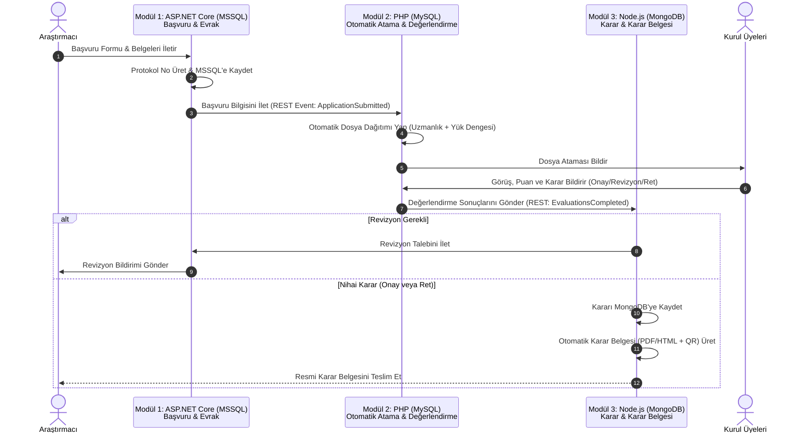

# Etik Kurul Otomasyonu - Sistem Tasarım Dokümanı (Design Spec)

**Tarih:** 2026-10-17  
**Proje Adı:** Etik Kurul Otomasyonu (Ethics Committee Automation System)  
**Hedef Dizin:** `C:\Users\PC\Desktop\Antigravity Projects\EtikKurulOtomasyonu`

---

## 1. Genel Bakış ve Amaç
Akademik araştırma, tez veya kurumsal projeler için etik kurul onayına başvuracak araştırmacıların başvuru formlarını ve belgelerini dijital olarak iletmesini, kurul üyelerine otomatik dosya ataması yapılarak üyelerin görüş ve değerlendirme bildirmesini, revizyon talepleri, ret veya onay kararlarının dijital ortamda tutularak resmi karar belgesinin otomatik oluşturulmasını sağlayan çok modüllü hibrit otomasyon sistemidir.

Kullanıcı direktifi doğrultusunda sistem, belirtilen 3 ana teknoloji yığını ile modüler olarak tasarlanmıştır:
1. **ASP.NET Core (.NET 9) + MSSQL:** Başvuru & Belge Yönetimi Modülü
2. **PHP + MySQL:** Kurul Üyeleri, Otomatik Dosya Dağıtımı & Değerlendirme Modülü
3. **Node.js (Express) + MongoDB:** Revizyon & Karar Yönetimi, Otomatik Karar Belgesi (PDF/HTML) Üretim Modülü

---

## 2. Modüler Mimari Yapısı

```
EtikKurulOtomasyonu/
│
├── 1-BasvuruModulu_DotNet/            # [ASP.NET Core 9 + MSSQL]
│   ├── Controllers/                   # ApplicationsController, DocumentsController, ResearchersController
│   ├── Data/                          # ApplicationDbContext, MSSQL Configuration, Seeder
│   ├── Models/                        # Researcher, Application, ApplicationDocument, ApplicationStatus
│   ├── Services/                      # ApplicationService, DocumentStorageService
│   ├── DTOs/                          # Başvuru ve dosya aktarım modelleri
│   ├── appsettings.json               # MSSQL bağlantı ayarları
│   └── Program.cs                     # API Başlatıcı ve DI yapılandırması
│
├── 2-DegerlendirmeModulu_PHP/         # [PHP + MySQL]
│   ├── config/                        # database.php (MySQL PDO bağlantısı)
│   ├── controllers/                   # EvaluationController, AssignmentController, MemberController
│   ├── models/                        # CommitteeMember, FileAssignment, MemberEvaluation
│   ├── services/                      # AutoAssignmentService (Yük dengeleme & uzmanlık eşleme)
│   ├── views/                         # Değerlendirme & Görüş bildirme HTML şablonları
│   ├── api/                           # REST API uçları
│   └── index.php                      # Giriş noktası ve yönlendirici (Router)
│
├── 3-KararVeBelgeModulu_Node/         # [Node.js + MongoDB]
│   ├── src/
│   │   ├── config/                    # db.js (Mongoose MongoDB bağlantısı)
│   │   ├── models/                    # Decision.js, RevisionRequest.js, AuditLog.js
│   │   ├── controllers/               # decisionController.js, documentController.js
│   │   ├── services/                  # certificateGenerator.js (PDF/HTML Karar Belgesi Üretici)
│   │   ├── routes/                    # apiRoutes.js
│   │   └── app.js                     # Express uygulaması ve sunucu
│   ├── package.json
│   └── templates/                     # Resmi Karar Belgesi (Protokol & Onay/Ret Sertifikası)
│
├── docker-compose.yml                 # MSSQL, MySQL, MongoDB ve 3 servisi ayağa kaldıran yapılandırma
├── start-all.ps1                      # Windows PowerShell başlatma betiği
└── README.md                          # Kapsamlı sistem ve API kılavuzu
```

---

## 3. Modül İşlev ve Veri Detayları

### 3.1. Modül 1: Başvuru & Belge Yönetimi (ASP.NET Core + MSSQL)
- **Sorumluluk:**
  - Araştırmacı kaydı ve kimlik doğrulaması.
  - Araştırma türü seçimi: Tez (Yüksek Lisans/Doktora), Akademik Araştırma, Kurumsal Proje (TÜBİTAK/BAP vb.).
  - Başvuru formu alanları: Proje Başlığı, Özet, Araştırma Yöntemi, Hedef Kitle/Gönüllü Sayısı, Risk Analizi.
  - Dijital evrak yükleme: Araştırma Protokolü, Bilgilendirilmiş Onam Formu, Veri Toplama Araçları (Anket/Ölçek).
  - Benzersiz Başvuru Protokol Numarası üretimi (Örn: `ETIK-2026-00142`).
  - Başvuru yaşam döngüsü durumu: `Draft`, `Submitted`, `UnderReview`, `RevisionRequested`, `Approved`, `Rejected`.
- **Veritabanı (MSSQL):**
  - Tablolar: `Researchers`, `Applications`, `ApplicationDocuments`, `ApplicationStatusHistory`.

### 3.2. Modül 2: Kurul Değerlendirme & Otomatik Atama (PHP + MySQL)
- **Sorumluluk:**
  - Etik Kurul üyeleri yönetimi (Unvan, Uzmanlık Alanı, Mevcut Aktif Dosya Sayısı).
  - **Akıllı Otomatik Dosya Dağıtımı (Auto-Assignment Algorithm):**
    - Yeni başvuru geldiğinde, başvurunun konusu ile kurul üyelerinin uzmanlık alanını eşleştirir.
    - Eşit uzmanlıklarda, üzerinde en az dosya bulunan kurul üyelerini (Round-Robin / Load Balancing) tespit ederek dosyayı en az 2 veya 3 raportör/jüri üyesine otomatik atar.
  - Üye Görüş ve Değerlendirme Bildirimi:
    - Etik Uygunluk Puanlama (1-5 arası kriterler).
    - Karar Tercihi: `Onay`, `Düzeltme/Revizyon`, `Ret`.
    - Gerekçe ve Detaylı Görüş Notu girişi.
- **Veritabanı (MySQL):**
  - Tablolar: `committee_members`, `file_assignments`, `evaluations`, `review_criteria`.

### 3.3. Modül 3: Revizyon, Karar & Otomatik Karar Belgesi (Node.js + MongoDB)
- **Sorumluluk:**
  - Revizyon Süreci Takibi: Kurul üyelerinin revizyon taleplerini konsolide etme, araştırmacıya iletme ve revize edilen dosyaları versiyonlama.
  - Nihai Kurul Kararı: Üye değerlendirmelerini harmanlayarak oybirliği / oyçokluğu kararını kaydetme.
  - **Otomatik Karar Belgesi (Decision Certificate) Üretimi:**
    - Onaylanan veya reddedilen başvurular için resmi formatta, protokol numaralı, tarihli, karar özeti ve gerekçesini içeren resmi PDF / HTML karar belgesi üretir.
    - Belge üzerine güvenli dijital doğrulama kodu ve QR kod yerleştirir.
  - Denetim İzi (Audit Log): Tüm işlem geçmişini NoSQL esnek doküman yapısında saklar.
- **Veritabanı (MongoDB):**
  - Koleksiyonlar: `decisions`, `revisions`, `audit_logs`, `generated_documents`.

---

## 4. Entegrasyon ve Veri Akışı (Workflow)



---

## 5. Doğrulama ve Test Kriterleri
1. ASP.NET Core modülünün `dotnet build` ve testlerinin hatasız geçmesi.
2. PHP modülünün syntax ve iş mantığı testlerinden hatasız geçmesi, otomatik atama algoritmasının yük dengelemesini doğru çalıştırması.
3. Node.js modülünün `npm test` ile karar ve belge üretim fonksiyonlarını başarıyla test etmesi.
4. Uçtan uca iş akışının (Başvuru -> Otomatik Atama -> Değerlendirme -> Karar -> Otomatik Belge) başarıyla tamamlandığının gösterilmesi.
